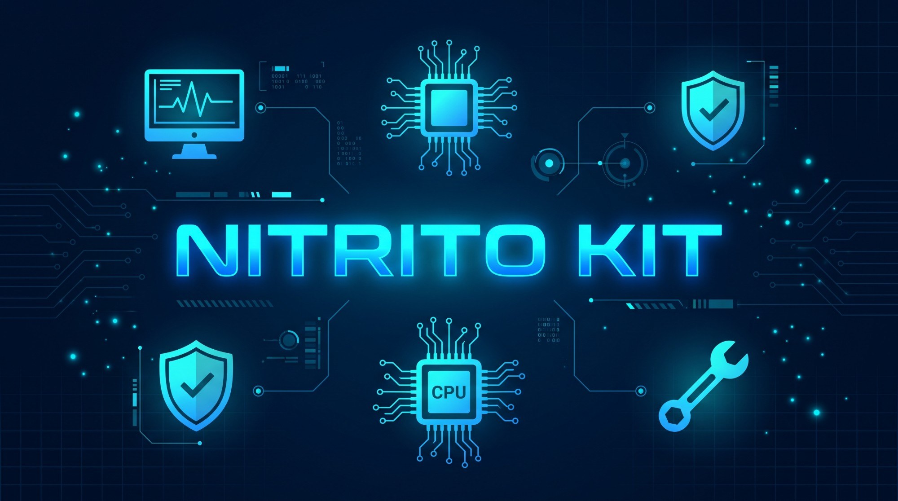

<p align="center"></p>

# Nitrit0 Kit

Kit portátil de **soporte técnico para Windows 10 y 11**, en castellano. Una app de escritorio (Electron) y más de 90 scripts de PowerShell 5.1 para
diagnosticar, probar el hardware, reparar y mantener un equipo, pensado para llevar en un pendrive y usar en equipos de clientes, amigos o propios.

> **Estado:** primera versión pública. Se usa a diario en taller, pero es un proyecto personal: léete el apartado [Límites y avisos](#límites-y-avisos) antes de usarlo.

## Qué hace

- **Revisión total del equipo:** *chequeo de salud* (unos 5 min) o *revisión a fondo* (unos 30 min). Lanza las pruebas una tras otra, da una nota de 0 a 100,
  un semáforo por áreas y una lista de lo que arreglar.
- **Diagnóstico:** 17 pruebas rápidas y 22 en el modo profundo (sistema, CPU, memoria, discos y SMART, red, eventos y pantallazos, integridad de Windows,
  seguridad, actualizaciones, arranque). Compara con la vez anterior y propone el siguiente paso para cada problema.
- **Pruebas del equipo, dentro de la app y sin internet:** pantalla (píxeles muertos y colores a pantalla completa), teclado (con detector de rebotes),
  ratón y táctil, webcam, audio y micrófono, mando (botones, deriva y vibración), **procesador** (cálculo verificado y puntuación) y **placa de vídeo**
  (WebGPU: memoria de vídeo con patrones y cálculo verificado). Cada una da *Pasa*, *Falla* o *No evaluado*: lo que no se puede evaluar nunca cuenta como fallo.
- **Reparación y mantenimiento:** arranque y WinRE, red, Windows Update (y por qué falla), Inicio/barra/Explorador, audio y privacidad, Office, WMI y runtimes,
  drivers, impresoras, Bluetooth, perfil de usuario, TPM.
- **Discos y USB:** salud y SMART, limpieza profunda, optimización (TRIM), prueba de **capacidad real** de pendrives y tarjetas (detecta los falsificados),
  prueba de velocidad por puerto USB, clonador de Windows a otro disco (solo en las compilaciones personales).
- **Ajustes de Windows** y **ajustes rápidos de soporte**, con su estado actual y el valor recomendado.

## Principios de diseño

- **Todo lo que cambia el sistema se puede deshacer.** Los cambios se anotan (registro, servicios, DNS, IP, arranque, paginación) y «Deshacer cambios» los revierte;
  los scripts que modifican algo aceptan `-SoloAnalizar`.
- **Verificación antes de ejecutar:** cada script y herramienta se comprueba contra una huella SHA-256 (`Datos\Integridad.json`).
- **Sin datos de clientes en el pendrive** en el modo público: los informes y registros van a la carpeta temporal del equipo.
- **Nunca se parsea texto traducido** de comandos de Windows: se usan objetos, códigos de salida y valores fijos para que funcione en cualquier idioma.

## Descarga y uso

1. En [Releases](../../releases) descarga la última versión **Lite** y su fichero `.sha256`.
2. Comprueba la huella: `Get-FileHash .\Nitrit0_Kit_Lite_*.7z -Algorithm SHA256` y compárala con la publicada.
3. Descomprime y abre `Nitrit0.exe` (pide permisos de administrador). Empieza en modo sencillo.

La versión **Lite no incluye las herramientas portables de terceros** (CPU-Z, HWiNFO, OCCT, antivirus portables, etc.): cada una tiene su propia licencia y su autor la
distribuye desde su web. Mira [`Herramientas_de_terceros.md`](Herramientas_de_terceros.md). Las que falten aparecen como «No está en la carpeta Apps»; los scripts propios y las pruebas
del equipo funcionan sin ellas.

## Compilar desde el código

Requisitos: Windows 10/11, Node.js y PowerShell 5.1 (`powershell.exe`, no `pwsh`).

```powershell
cd App
npm ci
npm run dev                 # app en modo desarrollo
npm run empaquetar:unico    # Nitrit0.exe portable
npm run limpieza            # Nitrit0_Limpieza.exe
cd ..
# Validar scripts y catálogo, y recalcular las huellas:
powershell.exe -NoProfile -ExecutionPolicy Bypass -File Scripts\Validar_Kit.ps1 -Corregir -Analizador
powershell.exe -NoProfile -ExecutionPolicy Bypass -File Scripts\Regenerar_Integridad.ps1
# Paquete publicable sin herramientas de terceros:
powershell.exe -NoProfile -ExecutionPolicy Bypass -File Scripts\Crear_Packs.ps1 -Lite -Destino .\_Packs
```

Estructura: `App\` (app Electron + React), `Scripts\` (motor, catálogo y `Mantenimiento\*.ps1`), `Scripts\Pruebas\` (pruebas del equipo en HTML), `docs\` (notas de diseño y auditorías).

## Límites y avisos

- Los ejecutables **no están firmados**: Windows SmartScreen o tu antivirus pueden avisar. Descárgalos solo de las Releases de este repositorio y comprueba el SHA-256.
- Pide **permisos de administrador** porque la mayoría de reparaciones los necesitan.
- Es una herramienta de soporte técnico: úsala en equipos tuyos o con permiso de su dueño y **haz copia de tus datos antes de reparar**. Se entrega tal cual, sin garantía.
- La prueba de placa de vídeo usa WebGPU de Chromium: depende del driver; en una placa defectuosa puede reiniciar el driver (se informa como fallo).
- Una prueba de unos minutos no descarta fallos que solo aparecen tras horas de carga.

Más detalle en [`SECURITY.md`](SECURITY.md).

## Apoyar el proyecto

Es gratuito y MIT. Si te ha ahorrado tiempo y quieres echar una mano, puedes hacerlo por [PayPal](https://paypal.me/Nitritog). No hace falta.

## Licencia

[MIT](LICENSE) para el código y los textos de este repositorio. Los programas de terceros que coloques en `Apps\` mantienen sus propias licencias.
